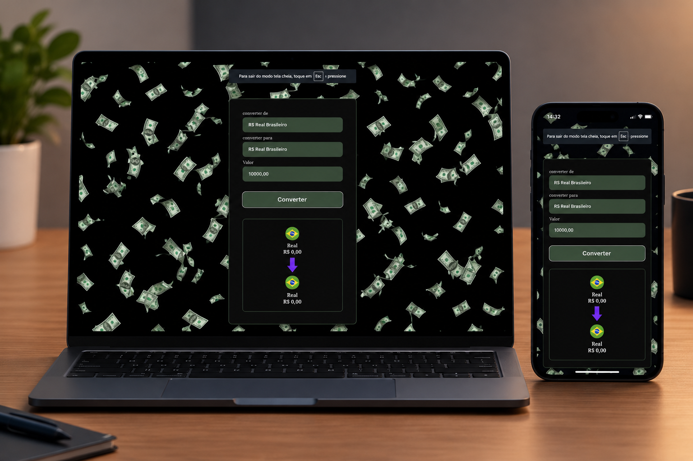

# 💱 Conversor de Moedas

Projeto de conversor de moedas desenvolvido para realizar conversões entre diferentes moedas usando taxas de câmbio atualizadas em tempo real.

## 📸 Demonstração



## 🚀 Funcionamento

O conversor permite:

1. **Selecionar a moeda de origem** — Escolha entre Real (BRL), Dólar Americano (USD), Euro (EUR), Bitcoin (BTC) e Libra (GBP).
2. **Selecionar a moeda de destino** — Escolha a moeda para a qual deseja converter.
3. **Inserir o valor** — Digite o valor a ser convertido no campo numérico.
4. **Converter** — Clique no botão "Converter" para exibir o resultado atualizado.

As taxas de câmbio são obtidas automaticamente da API [AwesomeAPI](https://economia.awesomeapi.com.br/) (endereço: `https://economia.awesomeapi.com.br/last/USD-BRL,EUR-BRL,BTC-BRL,GBP-BRL`).

Os ícones e nomes das moedas são atualizados dinamicamente conforme a seleção, e os valores são formatados conforme o padrão monetário de cada moeda utilizando `Intl.NumberFormat`.

## 🛠️ Tecnologias Utilizadas

- **HTML5** — Estrutura da página
- **CSS3** — Estilização e layout responsivo
- **JavaScript (ES6+)** — Lógica de conversão, consumo de API e atualização da interface
- **AwesomeAPI** — Fornecimento das taxas de câmbio em tempo real

## 📁 Estrutura do Projeto

```
Projeto-conversor-moedas/
├── index.html        # Página principal
├── style.css         # Estilos da aplicação
├── script.js         # Lógica de conversão e integração com API
├── README.md         # Documentação do projeto
└── assets/           # Imagens e recursos estáticos
    ├── readme.jpg    # Imagem da demonstração
    ├── background.jpg
    ├── brasil.png
    ├── usa.png
    ├── euro.png
    ├── libra.png
    ├── bitcoin.png
    └── seta.png
```

## 🖥️ Como Executar

1. Clone este repositório:
   ```bash
   git clone https://github.com/seu-usuario/conversor-moedas.git
   ```
2. Acesse a pasta do projeto:
   ```bash
   cd conversor-moedas
   ```
3. Abra o arquivo `index.html` no seu navegador.

## 📄 Licença

Este projeto está sob a licença MIT.
